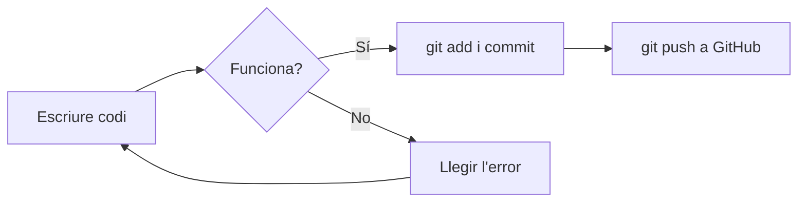
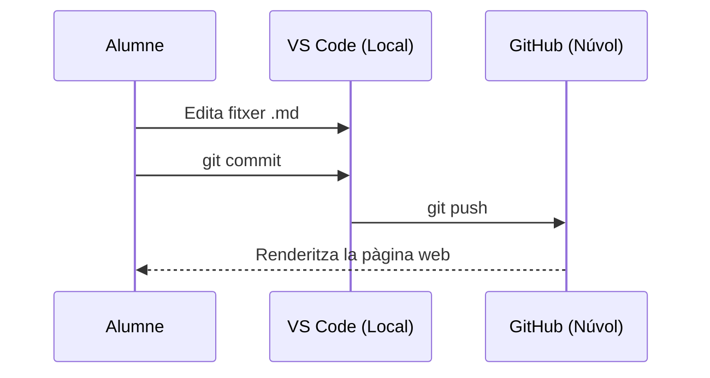
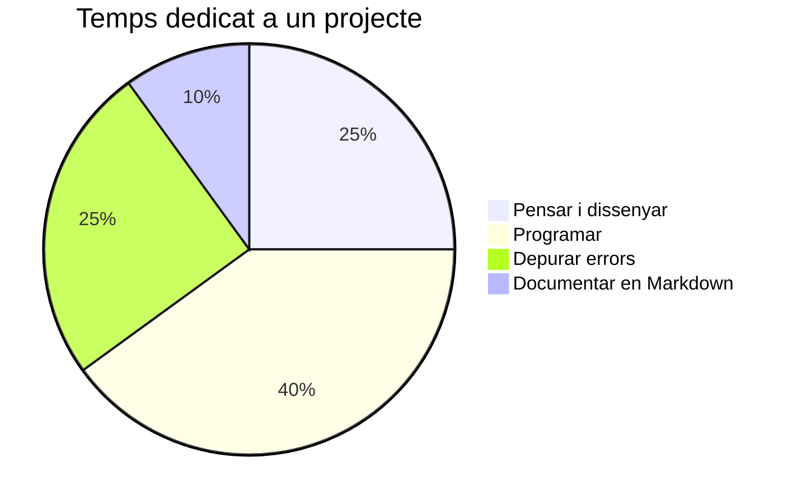

# Guia completa de Markdown

> [!NOTE]
> Aquest document mostra **tot el que es pot inserir en un fitxer Markdown** (CommonMark + GitHub Flavored Markdown + extensions habituals a VS Code i GitHub).
> Si el veus en **previsualització** (`Ctrl+Shift+V` a VS Code) o pujat a **GitHub**, veuràs com es renderitza cada element.

---

## 1. Encapçalaments

# Títol de nivell 1 (`#`)
## Títol de nivell 2 (`##`)
### Títol de nivell 3 (`###`)
#### Títol de nivell 4 (`####`)
##### Títol de nivell 5 (`#####`)
###### Títol de nivell 6 (`######`)

També existeix la sintaxi alternativa amb guions per a nivell 1 (`===`) i nivell 2 (`---`).

---

## 2. Format de text en línia

- **Negreta** amb `**text**` o `__text__`
- *Cursiva* amb `*text*` o `_text_`
- ***Negreta i cursiva*** amb `***text***`
- ~~Text ratllat~~ amb `~~text~~`
- `Codi en línia` amb `` `codi` `` (si el codi porta un backtick a dins, usa doble backtick: `` `` `codi` `` ``)
- Superíndex i subíndex (amb HTML): $2^{10}$ o `2<sup>10</sup>` → 2<sup>10</sup> · `H<sub>2</sub>O` → H<sub>2</sub>O
- Ressaltat (amb HTML `<mark>`): <mark>Text destacat en groc</mark>
- Combinació de tecles (amb `<kbd>`): <kbd>Ctrl</kbd> + <kbd>Shift</kbd> + <kbd>P</kbd>
- Caràcters escapats amb `\`: \*no és cursiva\*, \# no és títol, \`no és codi\`
- Salt de línia forçat: dues espais al final de la línia o `<br>`

---

## 3. Llistes

### Llista sense ordenar (`-`, `*` o `+`)

- Llenguatges compilats
  - C
  - C++
  - Rust
- Llenguatges interpretats
  - Python
  - JavaScript

### Llista ordenada (`1.`, `2.`, ...)

1. Clonar el repositori (`git clone`)
2. Crear una branca nova (`git switch -c millora`)
   1. Editar els fitxers
   2. Comprovar els canvis (`git status`)
3. Fer el `commit` i el `push`

### Llista de tasques (Checkboxes)

- [x] Instal·lar VS Code
- [x] Configurar Git i GitHub
- [ ] Entregar la pràctica de Markdown
- [ ] Fer el qüestionari de repàs

### Llista de definicions (suportada en alguns visors com Pandoc / MkDocs)

Markdown
: Llenguatge de marques lleuger creat per John Gruber l'any 2004.

GFM
: *GitHub Flavored Markdown*, l'extensió que afegeix taules, tasques i blocs de codi amb llenguatge.

---

## 4. Cites i avisos (Alerts / Callouts)

### Cita simple i niada

> «Els programes s'han d'escriure perquè els llegeixin les persones, i només incidentalment perquè els executin les màquines.»
> — Harold Abelson
>
> > Cita niada dins d'una altra cita, fins i tot amb **negreta** i `codi`.

### Avisos de GitHub (Alerts)

> [!NOTE]
> Informació útil que convé tenir present mentre es llegeix la documentació.

> [!TIP]
> Consell pràctic: a VS Code prem `Ctrl+K V` per obrir la previsualització al costat del codi.

> [!IMPORTANT]
> Requisit clau: tots els fitxers del projecte han d'estar codificats en UTF-8.

> [!WARNING]
> Compte! No pugis mai contrasenyes ni claus API a un repositori públic.

> [!CAUTION]
> Perill: `rm -rf` o `git reset --hard` esborren canvis de manera irreversible.

---

## 5. Enllaços i imatges

- Enllaç estàndard: [Documentació oficial de Markdown](https://www.markdownguide.org "Guia de Markdown")
- Enllaç automàtic: <https://github.com>
- Enllaç per referència: consulta la [secció de taules](#6-taules) o la [guia de Git][git-doc].
- Imatge en línia (amb text alternatiu i títol):


- Imatge que alhora és un enllaç clicable:

[](https://github.com)

[git-doc]: https://git-scm.com/doc "Documentació oficial de Git"

---

## 6. Taules

### Taula amb alineacions (`:---` esquerra, `:---:` centre, `---:` dreta)

| Format | Extensió | Separador | Ús habitual | Mida típica |
| :--- | :---: | :---: | :--- | ---: |
| **CSV** | `.csv` | Coma `,` (o `;`) | Fulls de càlcul i dades | 12 KB |
| **TSV** | `.tsv` | Tabulador `\t` | Bases de dades i text amb comes | 14 KB |
| **JSON** | `.json` | Claus `{}` i `:` | APIs web i configuració | 18 KB |
| **YAML** | `.yaml` | Sagnat i `:` | GitHub Actions i Docker | 4 KB |

---

## 7. Dades tabulars: CSV i TSV

A GitHub (i amb extensions de VS Code), els blocs `csv` i `tsv` es poden **ressaltar** o fins i tot **renderitzar automàticament com a taula**.

### Bloc `csv` (Comma-Separated Values)

```csv
id,nom,grup,nota_python,nota_git,apte
1,Laia Puig,1BAT-PR,8.5,9.0,true
2,Marc Soler,1BAT-PR,7.2,8.0,true
3,Núria Vila,1BAT-PR,9.4,9.5,true
4,Pau Roca,1BAT-PR,6.8,7.5,true
```

### Bloc `tsv` (Tab-Separated Values)

> [!TIP]
> Fixa't que en un **TSV** les columnes estan separades per un **caràcter tabulador real (`\t`)**, no per espais. Això permet tenir comes dins del text sense necessitat de cometes.

```tsv
codi	component	preu_eur	estoc	observacions
R-220	Resistència 220 Ω	0.05	150	Per a LEDs de 5 V, paquet estàndard
LED-R	LED vermell 5 mm	0.10	80	Càtode curt, 20 mA màxim
UNO-R3	Placa Arduino Uno R3	24.90	12	Inclou cable USB-B, microcontrolador ATmega328P
SR04	Sensor ultrasons HC-SR04	3.50	25	Abast de 2 cm a 400 cm, 4 pins
```

---

## 8. Blocs de codi en múltiples llenguatges

Pots indicar el llenguatge just després dels tres backticks inicials (```` ```python ````) per activar el **ressaltat de sintaxi**.

### Python

```python
def mitjana(notes: list[float]) -> float:
    """Calcula la mitjana aritmètica d'una llista de notes."""
    if not notes:
        return 0.0
    return sum(notes) / len(notes)

alumnes = {"Laia": [8.5, 9.0], "Marc": [7.2, 8.0]}
for nom, llista in alumnes.items():
    print(f"{nom}: {mitjana(llista):.2f}")
```

### JavaScript

```javascript
const sensors = [
  { nom: "Temperatura", valor: 22.4, unitat: "°C" },
  { nom: "Humitat", valor: 58, unitat: "%" },
];

const resum = sensors.map((s) => `${s.nom}: ${s.valor} ${s.unitat}`);
console.log(resum.join(" | "));
```

### HTML

```html
<!DOCTYPE html>
<html lang="ca">
  <head>
    <meta charset="UTF-8" />
    <title>Hola món</title>
  </head>
  <body>
    <h1>Benvinguts a 1BAT Programació</h1>
  </body>
</html>
```

### CSS

```css
.targeta {
  background-color: #f8fafc;
  border: 2px solid #2563eb;
  border-radius: 0.75rem;
  padding: 1rem 1.5rem;
}
```

### SQL

```sql
SELECT nom, AVG(nota) AS mitjana
FROM qualificacions
WHERE curs = '1BATPR'
GROUP BY nom
HAVING AVG(nota) >= 5.0
ORDER BY mitjana DESC;
```

### JSON

```json
{
  "curs": "1BAT-PR",
  "assignatura": "Programació i robòtica",
  "eines": ["VS Code", "Git", "Python", "Arduino"],
  "actiu": true,
  "hores_setmanals": 4
}
```

### YAML

```yaml
name: Comprova Markdown
on: [push, pull_request]
jobs:
  valida:
    runs-on: ubuntu-latest
    steps:
      - uses: actions/checkout@v4
      - run: echo "Tot correcte!"
```

### Bash / Terminal

```bash
#!/usr/bin/env bash
mkdir -p projecte && cd projecte
git init
echo "# El meu projecte" > README.md
git add README.md && git commit -m "Primer commit"
```

### C++ (Arduino / Robòtica)

```cpp
const int LED_PIN = 13;

void setup() {
  pinMode(LED_PIN, OUTPUT);
}

void loop() {
  digitalWrite(LED_PIN, HIGH);
  delay(500);
  digitalWrite(LED_PIN, LOW);
  delay(500);
}
```

### Rust

```rust
fn main() {
    let llenguatges = ["Python", "C++", "Rust", "SQL"];
    for (i, lleng) in llenguatges.iter().enumerate() {
        println!("{}: {}", i + 1, lleng);
    }
}
```

### Diff (canvis de Git)

```diff
 def saluda(nom):
-    print("Hola " + nom)
+    print(f"Hola, {nom}! Benvingut a classe.")
```

### Markdown dins de Markdown (amb quatre backticks ```` ```` ````)

````markdown
# Exemple dins un bloc
Això mostra la sintaxi literal de **Markdown** sense renderitzar-la:
```python
print("Hola!")
```
````

---

## 9. Fórmules matemàtiques (LaTeX / KaTeX)

En línia amb un dòlar (`$...$`): el teorema de Pitàgores és $a^2 + b^2 = c^2$, i la complexitat de la cerca binària és $\mathcal{O}(\log n)$.

En bloc centrat amb doble dòlar (`$$...$$`):

$$
x = \frac{-b \pm \sqrt{b^2 - 4ac}}{2a}
\qquad\qquad
\sum_{i=1}^{n} i = \frac{n(n+1)}{2}
$$

Matrius i sistemes:

$$
A = \begin{pmatrix}
1 & 2 & 3 \\
0 & 4 & 5 \\
0 & 0 & 6
\end{pmatrix}
$$

---

## 10. Diagrames (Mermaid)

GitHub i VS Code (amb l'extensió *Markdown Preview Mermaid Support*) dibuixen diagrames directament a partir de text.

### Diagrama de flux (`flowchart`)



### Diagrama de seqüència (`sequenceDiagram`)



### Gràfic circular (`pie`)



---

## 11. HTML incrustat dins Markdown

Quan Markdown es queda curt, accepta etiquetes HTML estàndard:

### Bloc desplegable (`<details>` + `<summary>`)

<details>
<summary>Fes clic aquí per veure la solució oculta</summary>

Pots posar-hi **Markdown normal** a dins (deixant una línia en blanc després de `</summary>`):

```python
print("Sorpresa! Això estava amagat.")
```

</details>

### Gràfic vectorial (`.svg`) referenciat

> [!NOTE]
> Per seguretat, GitHub filtra el `<svg>` escrit directament dins el `.md`, però el renderitza sense problemes si el deses en un fitxer `.svg` dins del repositori:


### Taula HTML amb cel·les combinades (`colspan` / `rowspan`)

<table>
  <thead>
    <tr>
      <th rowspan="2">Alumne</th>
      <th colspan="2">Avaluació</th>
    </tr>
    <tr>
      <th>Pràctica</th>
      <th>Teoria</th>
    </tr>
  </thead>
  <tbody>
    <tr>
      <td>Laia</td>
      <td>9.0</td>
      <td>8.5</td>
    </tr>
  </tbody>
</table>

<!-- Això és un comentari HTML: és al codi font del .md però no es mostra en projectar. -->

---

## 12. Notes al peu i emojis

### Notes al peu (Footnotes)

El format Markdown va ser dissenyat perquè el codi font fos fàcil de llegir tal qual[^1], sense etiquetes pesades com les d'HTML[^2].

[^1]: Vegeu l'especificació original de Daring Fireball (2004).
[^2]: Tot i això, Markdown permet barrejar HTML quan cal un control més fi.

### Emojis

- Codi curt (GitHub / Slack / Discord): `:rocket:` `:white_check_mark:` `:warning:` `:bulb:`
- Unicode directe (funciona arreu): 🚀 ✅ ⚠️ 💡 🦫 💻 📊
